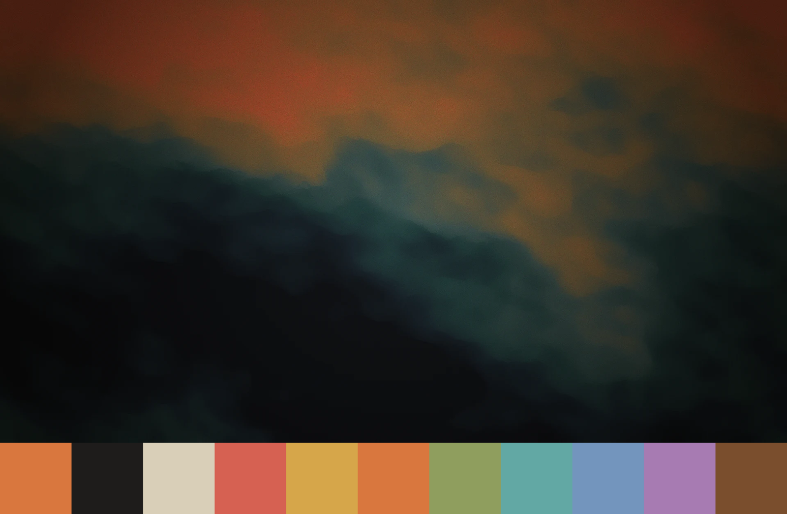

# Disco Elysium Night — Omarchy theme

A dark theme: dusk in oil paint over Martinaise. Cream ink `#d9cfb8` on warm charcoal `#1e1c1b`, burnt-orange accent `#d9773e`.



## Install

```bash
omarchy theme install https://github.com/duy211099/omarchy-disco-elysium-night-theme
```

Companion theme: [Disco Elysium Day](https://github.com/duy211099/omarchy-disco-elysium-day-theme)

## Palette

Terminal colors follow the game's four skill groups:

| Skill group | Color |
|---|---|
| Intellect | blue |
| Psyche | magenta |
| Physique | red |
| Motorics | ochre yellow |

Every text color is at least 4.5:1 against both `background` and `dark_background`.

Terminal, editor and app configs are generated by Omarchy from `colors.toml`.

## Wallpapers

Original abstract oil-paint style images generated with ImageMagick. No game artwork is included.

## Note

Fan-made and inspired by the look of *Disco Elysium*. Not affiliated with or endorsed by ZA/UM.
